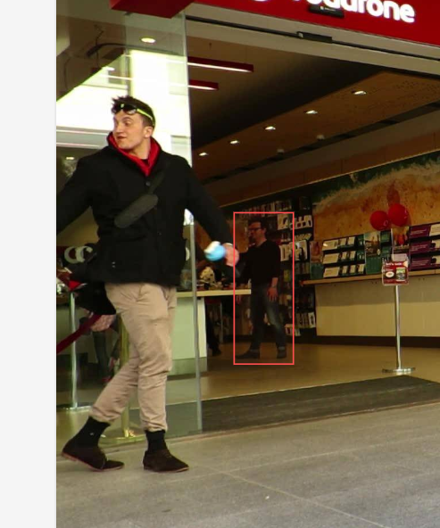
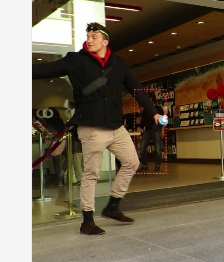
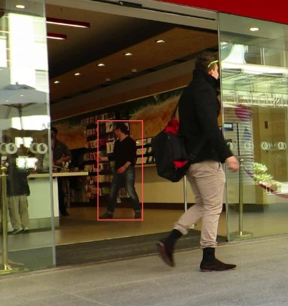

# Báo cáo cá nhân — Trần Khánh Chi - 2a202603338

Đoạn video: MOT17-09, 150 frame (frame 1–150), nguồn MOTChallenge, giấy phép CC BY-NC-SA 3.0.

## 0. Thông tin học viên

- Họ tên: Trần Khánh Chi
- MSSV: 2a202603338
- Mã đề: A
- Email: trankhanhchii20@gmail.com
- Link repository: (https://github.com/trankhanhchii-20/K5-L2-day05-TranKhanhChi-2a202603338-MOTTracking.git)
- Giờ bắt đầu: 17h00
- Giờ kết thúc: 23h30

## 1. Xem trước đoạn video (CP0)

Ghi **trước khi vẽ**, mỗi người một dòng. P1–P5 theo ảnh đề A (`de-A-P1-P5.jpg`); số frame theo CVAT (bắt đầu từ 0).

| Mã | Frame xuất hiện | Frame cuối thấy được | Rẽ / dừng / đổi tốc độ ở frame | Bị che ở frame | Ghi chú |
|---|---|---|---|---|---|
| P1 | 0 | 149 | Đi dần sang phải trong cửa hàng, chậm lại và quay ngược sang trái khoảng frame 105–120 | 30–53 (một phần) | Người áo đen bên trong Vodafone, đứng sau kính; bị anh áo khoác đen đi ngang phía trước che |
| P2 | 59 | 149 | Đi sang phải đến ~frame 120 rồi dừng / lùi lại nhẹ | 59–67 (một phần, lúc mới xuất hiện) | Người bên trong cửa hàng, phía trái; nhỏ, sau kính |
| P3 | 0 | 149 | Đi thẳng về phía camera và lệch trái, nhanh dần từ ~frame 75 | Không | Bà áo khoác xanh lá, đeo túi; box to dần rất nhanh (cao ~350 px → ~750 px) |
| P4 | 0 | 149 | Đi về phía camera cạnh P3, ra khỏi mép phải khung từ ~frame 85 | 0–2, 9–12, 23–24 (một phần) | Ông áo xanh dương, đội mũ; frame đầu chỉ thấy một phần ở mép phải ảnh |
| P5 | 0 | 110 | Đi sang phải đến ~frame 45 rồi đứng yên cạnh mẹ | 106–110 (một phần), từ 111 khuất hẳn | Bé gái áo trắng-xanh, nhỏ, ở xa trước Woolworths; bị P3 và người áo đen đi ngang che |

## 2. Keyframe và thời gian (CP1, CP4)

Số keyframe lấy từ kết quả `src/check_submission.py`.

| Mã | Track CVAT | Số keyframe | Keyframe ở frame | Số frame có mặt | Keyframe / 100 frame | Thời gian (phút) | Chỗ khó |
|---|---:|---|---|---|---|---|---|
| P1 | 4 | 32 | 0, 5, 10, 18, 20, 30, 33, 36, 39, 41, 42, 48, 51, 54, 61, 64, 67, 69, 70, 74, 81, 89, 91, 101, 103, 111, 114, 121, 131, 141, 144, 149 | 150 | 21.3 | ~35 | Đứng sau kính, bị che 24 frame (30–53) — phải đoán phần thân bị khuất |
| P2 | 3 | 23 | 59, 60, 62, 63, 66, 68, 74, 75, 78, 79, 88, 98, 108, 109, 110, 111, 116, 117, 118, 128, 138, 148, 149 | 91 | 25.3 | ~20 | Xuất hiện ở frame 59 khi đang bị che; ban đầu vẽ nhầm box chỉ phần thân trên (59–67), sau review sửa thành box toàn thân |
| P3 | 0 | 46 | 0, 10, 13, 20, 27, 30, 36, 40, 41, 42, 51, 52, 54, 57, 58, 59, 60, 65, 67, 68, 71, 74, 77, 79, 81, 82, 91, 94, 98, 101, 102, 103, 111, 116, 118, 121, 122, 123, 125, 129, 131, 132, 133, 141, 142, 149 | 150 | 30.7 | ~30 | Lại gần camera, box phóng to liên tục, tay và túi làm bề ngang thay đổi |
| P4 | 1 | 38 | 0, 2, 3, 9, 10, 13, 15, 18, 21, 22, 23, 25, 28, 34, 35, 39, 45, 55, 65, 75, 80, 85, 89, 95, 101, 105, 115, 125, 126, 127, 128, 129, 132, 134, 135, 140, 145, 149 | 150 | 25.3 | ~25 | Bị cắt ở mép phải khung và sát P3, dễ lẫn mép box giữa hai người |
| P5 | 2 | 10 | 0, 10, 17, 18, 19, 29, 30, 39, 59, 106 | 111 | 9.0 | ~10 | Rất nhỏ; đoạn che cuối 106–110 rồi khuất hẳn đến hết video |
| **Tổng** | | 149 | | 652 | 22.9 | ~120 (+ ~1h review/xuất file, sửa) | |

Ghi chú: số frame tính theo CVAT (bắt đầu từ 0). Mã P1–P5 lấy theo ảnh đề A, **không** trùng thứ tự track trong CVAT; cột "Track CVAT" ghi ID track tương ứng (trong `gt.txt` là ID + 1). Thời gian từng người là ước lượng, tổng khoảng hơn 3 giờ (16h30–19h00 và 22h30-23h30).

Keyframe / 100 frame của cả bài = tổng keyframe ÷ tổng số frame có mặt × 100 = 149 ÷ 652 × 100 = 22.9

Bạn đặt keyframe nhiều nhất ở người nào? Vì sao (người đó rẽ, dừng, lại gần camera hay bị che)?

Nhiều nhất là **P3** (46 keyframe, 30.7 / 100 frame). P3 đi thẳng về phía camera nên box to ra liên tục và không đều (chiều cao từ ~350 px ở frame 0 lên ~750 px ở frame 135), đồng thời tốc độ tăng dần từ khoảng frame 75. Nội suy tuyến tính giữa hai keyframe xa nhau làm box hụt chân hoặc lệch ngang, cộng thêm tay vung và túi xách làm bề ngang thay đổi theo bước chân, nên phải chèn keyframe dày hơn. Người thứ hai là P4 (38) vì cũng lại gần camera, bị mép khung cắt và đi sát P3. Ngược lại P5 chỉ cần 10 keyframe vì bé đứng yên từ khoảng frame 45.

## 3. Đoạn bị che (CP2)

Người bị che: `P1` (track CVAT 4)

| Mốc | Frame |
|---|---:|
| Bắt đầu bị che một phần (bật `occluded`) | 30 |
| Mất hẳn (bật `outside`) | Không bật - luôn còn thấy một phần |
| Hiện lại (tắt `outside`) | Không áp dụng |
| Thấy rõ trở lại (tắt `occluded`) | 54 |

- Thời gian khuất hẳn: 0 frame = 0 giây (bị che một phần 24 frame, 30–53 ≈ 0,8 giây ở 30 fps).
- Quyết định: giữ cùng ID.
- Lý do (trả lời 3 câu: khuất bao lâu so với 60 frame, ngoại hình có khớp, chỗ hiện lại có đúng hướng và tốc độ):

  1. P1 không khuất hẳn lần nào; đoạn bị che một phần chỉ 24 frame, ngắn hơn nhiều ngưỡng 60 frame.
  2. Ngoại hình khớp: cùng áo đen, quần jeans, đứng sau quầy trong Vodafone, trước và sau khi anh áo khoác đen đi ngang qua.
  3. Vị trí sau khi hết che (frame 54, x ≈ 358–484) nằm đúng trên đường đi sang phải với tốc độ chậm như trước đó (x ≈ 320 ở frame 30), không có bước nhảy.

  Trong đoạn che, mình vẫn vẽ box ở vị trí ước lượng (cả phần thân bị khuất) và bật `occluded`, không bật `outside`.

  Trường hợp thứ hai: **P5** bị P3 và người áo đen che một phần từ frame 106 (`occluded` 106–110), rồi khuất hẳn từ **frame 111** (bật `outside`) và **không hiện lại** trước khi đoạn video kết thúc ở frame 149 (39 frame ≈ 1,3 giây). Vì bé không xuất hiện lại nên không tạo track mới. Nếu bé hiện lại thì vẫn giữ ID cũ vì 39 < 60 frame và bé đang đứng yên ở cùng chỗ.

Ảnh chụp màn hình (P1, frame trước / giữa / sau đoạn che 30–53):





## 4. Tự review ID (CP3)

Lượt 1 theo người (đi ngược từ frame 149 về 0 trên CVAT), lượt 2 theo cảnh (nhảy 10 frame). Ít nhất 3 dòng; không có lỗi thì ghi một dòng "đã kiểm hai lượt, không lỗi".

Loại lỗi dùng đúng một trong 7 mã: `id_switch`, `fragmentation`, `lost`, `merge`, `false_track`, `drift`, `flag`.

| Frame | Mã người | Loại lỗi | Mô tả một câu | Phát hiện ở lượt | Đã sửa? |
|---:|---|---|---|---|---|
| 59–67 | P2 (track 3, hiện là "person 4" trên CVAT) | `drift` | Lúc mới xuất hiện P2 đang bị che, bản đầu tiên chỉ vẽ box quanh phần thân trên nhìn thấy được (có bật `occluded`), sai quy ước amodal: box bị co, lệch khỏi vị trí toàn thân nên IoU với GT có thể rơi dưới 0,5, rồi "nhảy" to ra ở frame 68 khi hết che. | 1 | Đã sửa: kéo box ở các frame 59–67 ra vị trí ước lượng toàn thân (đầu → chân), giữ `occluded`, chạy lại `check_submission.py` |
| 0–149 | P1, P3, P4, P5 | — | Đã kiểm hai lượt, không lỗi khác: 5 track liền mạch, không đổi ID, cờ `occluded` / `outside` khớp đoạn che (P1 30–53, P5 106–111). | 1 và 2 | — |

Tổng hợp số lỗi theo loại (đã sửa hết, không còn lỗi trong file nộp):

| `id_switch` | `fragmentation` | `lost` | `merge` | `false_track` | `drift` | `flag` |
|---:|---:|---:|---:|---:|---:|---:|
| 0 | 0 | 0 | 0 | 0 | 1 | 0 |

Lỗi nào chỉ lượt 2 (theo cảnh) mới thấy, lượt 1 (theo người) không thấy? Vì sao?

Lỗi `drift` của P2 ở frame 59–67 được phát hiện ngay ở lượt 1. Khi đi ngược frame theo riêng P2 thì thấy rõ box đột ngột co lại chỉ còn nửa người lúc vào đoạn che, so với box toàn thân ở frame 68 trở đi. Sau khi sửa, không còn lỗi nào chỉ lượt 2 mới thấy. Chỗ mà lượt 2 kiểm kỹ nhất là các cặp người đi sát nhau: P3 với P4 (đi cạnh nhau về phía camera, box gần chạm nhau từ khoảng frame 120) và P1 với P2 (cùng ở trong cửa hàng sau kính). Lượt 1 chỉ theo một người, nên dù box có nhảy sang người bên cạnh thì nó vẫn trông "liền mạch". Lỗi `id_switch` hoặc `merge` giữa hai người đi sát chỉ thấy rõ khi nhìn cả cảnh cùng lúc: hai box đổi chỗ cho nhau, hoặc hai box cùng chồng lên một người.

## 5. File xuất và kết quả tự kiểm (CP4)

| Kiểm tra | Kết quả |
|---|---|
| Tên file MOT 1.1 | `Trankhanhchi_mot.zip` |
| Tên file CVAT for video 1.1 | `Trankhanhchi_cvat_video.zip` |
| Số track ID khác nhau trong `gt/gt.txt` (phải là 5) | 5 (tổng 652 box) — OK |
| Frame `outside` không có dòng trong `gt.txt` (đúng / sai) | Đúng — track 3 (P5) chỉ có dòng ở frame 0–110 (theo CVAT); frame 111–149 đang `outside` nên không có dòng. 652 box khớp 652 frame có mặt bên CVAT |
| Job đã completed trên CVAT máy cá nhân | Đã chuyển job 20 sang completed |

Dán phần tóm tắt in ra từ `src/check_submission.py`:

```text
Số frame in theo CVAT (bắt đầu từ 0). Trong gt.txt, frame_id = frame CVAT + 1.

=== File MOT 1.1: Trankhanhchi_mot.zip ===
  Số track ID: 5   |   Tổng số box: 652
  [OK]        Đúng 5 track ID.

  Track | Frame có mặt | Số frame | Đoạn vắng (outside)
      1 |   0–149      |      150 | -
      2 |   0–149      |      150 | -
      3 |   0–110      |      111 | -
      4 |   0–149      |      150 | -
      5 |  59–149      |       91 | -


=== File CVAT for video 1.1: Trankhanhchi_cvat_video.zip ===

  Track | Nhãn   | Frame thấy | Keyframe | KF/100 frame | Frame occluded | Lần bật outside
      0 | person |        150 |       46 |         30.7 |              0 |               0
              Track 0: keyframe ở frame [0, 10, 13, 20, 27, 30, 36, 40, 41, 42, 51, 52, 54, 57, 58, 59, 60, 65, 67, 68, 71, 74, 77, 79, 81, 82, 91, 94, 98, 101, 102, 103, 111, 116, 118, 121, 122, 123, 125, 129, 131, 132, 133, 141, 142, 149]
      1 | person |        150 |       38 |         25.3 |              9 |               0
              Track 1: keyframe ở frame [0, 2, 3, 9, 10, 13, 15, 18, 21, 22, 23, 25, 28, 34, 35, 39, 45, 55, 65, 75, 80, 85, 89, 95, 101, 105, 115, 125, 126, 127, 128, 129, 132, 134, 135, 140, 145, 149]
      2 | person |        111 |       10 |          9.0 |              5 |               1
              Track 2: keyframe ở frame [0, 10, 17, 18, 19, 29, 30, 39, 59, 106]
      3 | person |         91 |       23 |         25.3 |              9 |               0
              Track 3: keyframe ở frame [59, 60, 62, 63, 66, 68, 74, 75, 78, 79, 88, 98, 108, 109, 110, 111, 116, 117, 118, 128, 138, 148, 149]
      4 | person |        150 |       32 |         21.3 |             24 |               0
              Track 4: keyframe ở frame [0, 5, 10, 18, 20, 30, 33, 36, 39, 41, 42, 48, 51, 54, 61, 64, 67, 69, 70, 74, 81, 89, 91, 101, 103, 111, 114, 121, 131, 141, 144, 149]

  Tổng: 149 keyframe / 652 frame có mặt = 22.9 keyframe / 100 frame
  [OK]        Đọc được 5 track từ annotations.xml.

=== Tóm tắt ===
  Lỗi: 0   |   Cảnh báo: 0
  Đạt. Dán phần tóm tắt này vào báo cáo mục 5.
```

## 6. Ba câu kết

1. Nếu được gán lại, bạn sẽ đặt keyframe khác ở đâu? Vì sao?

   Ở P3, sẽ bớt các cụm keyframe sát nhau (40–41–42, 57–58–59–60, 121–122–123, 131–132–133). Các cụm đó là chỗ mình sửa từng frame vì box trôi. Cách làm hợp lý hơn là đặt keyframe ở những chỗ P3 đổi tốc độ (khoảng frame 75) và nơi kích thước box đổi nhanh, rồi để nội suy lo phần giữa; như vậy vẫn bám tốt mà xuống còn khoảng 30 keyframe. Ngược lại, ở P5 mình sẽ thêm một keyframe khoảng frame 45 (lúc bé bắt đầu đứng yên) để nội suy từ 39 đến 59 không bị lệch. Với P2, ngay từ frame 59 em sẽ vẽ box toàn thân ước lượng cho đoạn bị che. Như vậy không phải sửa lại sau, và không cần nhiều keyframe sát nhau (59, 60, 62, 63, 66) như hiện tại.

2. Có chỗ nào bạn không chắc "cùng ID hay ID mới"? Bạn đã quyết định và ghi chú thế nào?
Khong có

3. Một lỗi ID trong job của bạn (nếu không còn sót, chọn lỗi đã sửa) có thể làm xe tự lái dự đoán sai chuyển động của người đó như thế nào? Lỗi đó ảnh hưởng MOTA hay IDF1 nhiều hơn?

   Ví dụ lỗi có thể xảy ra: `id_switch` giữa P3 và P4 khi hai người đi sát nhau từ khoảng frame 120. Nếu ID bị tráo, lịch sử quỹ đạo của "P3" sẽ ghép nửa đầu của P3 với nửa sau của P4. Từ đó mô hình dự đoán tính ra vận tốc và hướng đi sai: nó thấy một cú nhảy ngang bất thường, nên có thể dự đoán người này sắp băng sang phải, hoặc làm mượt mà bỏ qua thay đổi thật. Xe tự lái sẽ phanh thừa hoặc, nguy hiểm hơn, không nhường đường cho người đang thật sự đi tới. Lỗi này ảnh hưởng IDF1 nhiều hơn**: MOTA chỉ trừ 1 IDSW trên tổng hơn 600 box GT nên gần như không đổi, còn IDF1 tính theo số frame được gán đúng danh tính suốt cả track, nên toàn bộ đoạn sau khi tráo ID của cả hai người đều bị tính sai.

## Bonus (nếu làm)

Không làm phần bonus.

## 7. Tài liệu tham khảo và công cụ AI đã dùng

- Tài liệu trong repo: `README.md`, `docs/GUIDELINE.md`, `docs/CVAT_CHEATSHEET.md`, `docs/CVAT_LOCAL_SETUP.md`, `docs/MOT_FORMAT.md`, `RUBRIC.md`, `lab_day05_walkthrough.md`.
- Công cụ: CVAT chạy local (Docker) để gán nhãn và xuất file MOT 1.1 / CVAT for video 1.1; `src/check_submission.py` để tự kiểm.
- Dữ liệu: MOT17-09, MOTChallenge (https://motchallenge.net), giấy phép CC BY-NC-SA 3.0.
- Metric: Bernardin & Stiefelhagen (2008) — CLEAR MOT (MOTA); Ristani et al. (2016) — IDF1.
- AI: dùng Claude để đọc file xuất `annotations.xml` (lấy frame `occluded` / `outside`, vị trí box), đối chiếu mã P1–P5 với ảnh đề A và hỗ trợ biên soạn lại báo cáo. Phần gán nhãn trên CVAT em tự làm.
